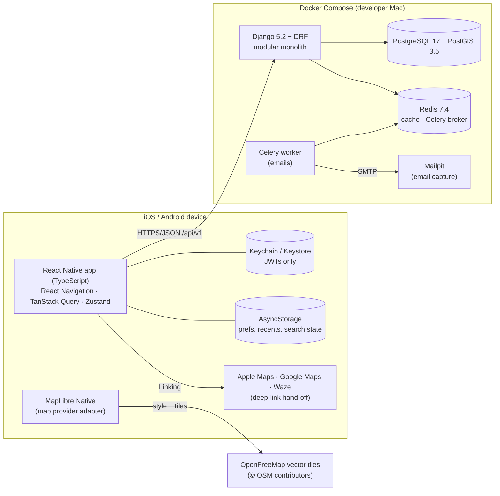

# Zpot system design (Part 1)

## 1. Overview

The mobile app always runs natively, through Metro and simulators or emulators. Only backend infrastructure runs in Docker.

## 2. Mobile architecture

| Layer | Location | Responsibility |
|---|---|---|
| App shell | `src/app/App.tsx` | Providers: safe area, QueryClient, theme, error boundary, toasts, NavigationContainer with deep links |
| Navigation | `src/navigation/` | Root native stack (onboarding, auth, modals, details) and 4-tab navigator. Typed params. Linking config. |
| Screens | `src/screens/{onboarding,auth,explore,parking,profile,shared}` | Presentation and orchestration only. No HTTP calls. |
| Features | `src/features/{auth,parking}` | Form schemas (Zod), auth completion, presentation mapping (API enums to localised copy) |
| Components | `src/components/{common,parking,maps,forms}` | Design-system components (`Zpot*`, `ParkingResultCard`, `ParkingStatusBadge`, `BottomSheet`, `DateTimeSelector`, and so on) |
| Data hooks | `src/hooks/` | React Query hooks (`useParkingOptions`, `useMapLayers`, `useAreaDetail`, `useAutocomplete`), online state |
| Services | `src/services/api` | Typed Axios client: base URL per platform, bearer injection, single-flight refresh, error normalisation (`ApiError`), timeouts, controlled GET retries, AbortSignal cancellation |
| | `src/services/auth` | Keychain token storage |
| | `src/services/location` | Foreground permission and position |
| | `src/services/maps` | Navigation hand-off URLs |
| State | `src/store/` | Zustand stores: `authStore` (session, pending return), `prefsStore` (persisted preferences), `searchStore` (persisted destination, plan, filters, selection, hand-off) |
| Theme / i18n | `src/theme`, `src/i18n` | Tokens from the prototype and logo. EN and PT-PT catalogues. |

**Business rules live on the server.** The app never decides legality or cost. It renders `category`, `legal_status`, `expected_total_cost`, `leave_by` and the other fields from the API. The only client-side filter is the presentational "include time-limited free options" toggle, which hides a category the API already classified.

## 3. Backend architecture (modular monolith)

| App | Part 1 | Contents |
|---|---|---|
| `core` | ✅ | Error envelope, request id, cursor pagination, `AuditEvent`, health, ready, config, features |
| `accounts` | ✅ | Custom `User` (UUID, case-insensitive unique email), `UserProfile`, `UserPreference`, `UserRole`, `DeviceRegistration`, `ConsentRecord`; JWT auth, verification and reset tokens; services layer |
| `cities` | ✅ | `City`, `SupportedArea` (coverage), `Place` gazetteer; geocoding provider abstraction (local, Nominatim) |
| `parking` | ✅ | `ParkingDataSource`, `StreetSegment`, `ParkingArea`, `ParkingEvidence`, `ParkingDataRevision`; canonical search service; seed command |
| `regulations` | ✅ | `ParkingRule`, `ParkingRestriction`, `ParkingTimeWindow`, `ParkingTariff`, `PermitType`, `TemporaryClosure`; pure evaluation engine; audit signals |
| `availability` | ◐ | `ParkingObservation` and read selector (writes in Part 2) |
| `reports`, `community`, `sessions`, `saved`, `notifications`, `support`, `privacy`, `monetization`, `scouts` | shells | Registered for traceability; built in Part 2 |

Within an app the layers are: `models` → `selectors` (query composition) → `services` (business logic, transactions) → `serializers` (I/O validation) → `views` (thin HTTP) → `urls`. Background work goes in `tasks.py` (Celery, eager in tests). Admin registrations live in `admin.py`.

## 4. Parking search pipeline

Every listing endpoint (`/parking/options/`, `/spots/nearby/`, `/parking/compare/`, `/parking/map-layers/`) runs through `apps/parking/services/search.py` and the engine.

1. **Validate.** `SearchQuerySerializer` checks types, ranges and combinations: destination pairs, `free_only` with `include_paid`, `max_price` requires paid, cursor, arrival window.
2. **Resolve the centre.** Destination if given, otherwise the device position. Coverage is checked by PostGIS containment against `City.boundary` and `SupportedArea.boundary`.
3. **Fetch candidates.** `ParkingArea.location` (geography, GiST-indexed) `ST_DWithin(radius)` plus `ST_Distance` annotation, ordered by distance and capped at 300. Rules, windows, tariffs, restrictions and closures are prefetched in about 8 queries.
4. **Evaluate.** Each area becomes an `AreaSpec`, and `engine.evaluate(spec, arrival, duration, driver)` splits the stay at every rule boundary in Europe/Lisbon local time. Precedence is closure > restriction (unless exempt) > permit/badge > paid (cheapest) > free > *nothing = UNKNOWN*. Max-stay accumulates while its window is active. Cost is billed per tariff increment for each contiguous paid run.
5. **Walking.** `distance × 1.25 detour ÷ 80 m/min`. Options beyond `max_walk_minutes` are dropped, but free ones are counted so the app can offer "walk up to 15 min".
6. **Filter.** Restricted is hidden unless `include_restricted`. Paid requires `include_paid` and respects `max_price`. Unknown is hidden by `verified_only`. `accessible_only` applies. Every hidden count is reported in `summary.hidden`.
7. **Rank.** `(category rank, paid cost, walk minutes, confidence, id)`. This is deterministic. **Commercial fields are never read.** The recommended option is the first free or free-with-time-rules result.
8. **Respond.** Section 8.8 fields, plus `recommendation_reason {code, params, text}`, evidence, freshness and a disclaimer. Pagination uses an opaque cursor.

## 5. Authentication and security boundaries

* JWT access tokens last 15 minutes. Refresh tokens last 30 days, rotate, and are blacklisted after rotation and on logout. Reset and delete revoke every refresh token.
* Email verification tokens are signed and time-limited (48 h). Password reset tokens use Django's single-use generator (2 h, invalidated by a password change).
* Throttling uses scoped `auth` (10/min) and `auth_email` (5/hour) limits, plus anon and user defaults. Password reset is enumeration-safe and always returns 202.
* Mobile tokens live only in the Keychain or Keystore (`AFTER_FIRST_UNLOCK_THIS_DEVICE_ONLY`). Passwords are never persisted. `scripts/gen-env.js` refuses `sk.*` secrets in the bundle.
* Ownership: `/users/me/*` only ever acts on `request.user`. Parking discovery is `AllowAny` (guest-first).
* Audit: `AuditEvent` records account actions. `ParkingDataRevision` records every rule, restriction and closure change.
* Errors share one envelope with a `request_id`. Stack traces are never sent to clients.

## 6. State management

* **Server state** uses React Query. Cache keys include every query parameter, `keepPreviousData` avoids map flicker, and requests are cancelled through AbortSignal. NetInfo is wired to `onlineManager`.
* **Client state** uses Zustand and is persisted to AsyncStorage selectively. Tokens are never stored there.

## 7. Maps

`ZpotMap` defines the provider contract (`ZpotMapProps` and the imperative `ZpotMapHandle`). The active provider is MapLibre Native with OpenFreeMap "liberty" vector tiles, which need no API key. Mapbox, the BRD/TRD preference, needs a secret download token, so it isn't built here. Enabling it is documented in `docs/development/maps.md`. Overlays come from `/parking/map-layers/` as GeoJSON:

* line and fill layers styled by category, with dashed lines for restricted and unknown
* clustered points below zoom 14
* labelled RN markers at zoom 14 and above
* destination pin and user location

## 8. Operational dependencies (local)

| Service | Image | Port | Health check |
|---|---|---|---|
| PostGIS | `imresamu/postgis:17-3.5` (multi-arch build of the official image; `postgis/postgis` has no arm64 build) | 5432 | `pg_isready` + `PostGIS_Version()` |
| Redis | `redis:7.4-alpine` | 6379 | `redis-cli ping` |
| Mailpit | `axllent/mailpit:v1.27` | 8025 UI / 1025 SMTP | `/mailpit readyz` |
| API | `./api/Dockerfile` (python:3.13-slim-trixie, GDAL 3.10) | 8000 | `/api/v1/health/` |
| Worker | same image | — | Celery |
