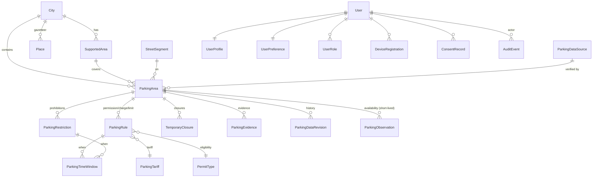

# Database schema (Part 1)

PostgreSQL 17 with PostGIS 3.5 and the `pg_trgm` and `unaccent` extensions, created in migration `cities.0001`. Timestamps are UTC (`USE_TZ=True`), and city-local time comes from `City.timezone`. Geometry uses SRID 4326. Distance and radius queries use `geography` (metres).

## Entity map

## Tables and key constraints

| Model | Notable fields | Constraints and indexes |
|---|---|---|
| `accounts.User` | UUID pk, email, `is_email_verified`, `email_verified_at` | unique email plus `UNIQUE(LOWER(email))` |
| `accounts.UserPreference` | language, `max_walk_minutes`, `free_only_default`, `offer_paid_alternatives`, reminder, `vehicle_class`, `permit_type` FK, badge, personalisation, analytics, ads | CHECK walk 1–30, reminder ≤ 120 |
| `accounts.UserRole` | role ∈ driver, scout, data_reviewer, admin | UNIQUE(user, role) |
| `accounts.DeviceRegistration` | platform, `push_token` | UNIQUE(platform, push_token) |
| `accounts.ConsentRecord` | `consent_type`, `document_version`, granted, `recorded_at` | append-only; index (user, type, -recorded_at) |
| `core.AuditEvent` | action, actor (SET NULL), target, metadata, ip | index action, `created_at` |
| `cities.City` | slug, timezone, currency, center Point, boundary MultiPolygon, `is_supported` | unique slug |
| `cities.SupportedArea` | boundary MultiPolygon, coverage ∈ full, partial, mapping | UNIQUE(city, slug); GiST |
| `cities.Place` | name, subtitle, kind, location geography | GIN trigram on `UPPER(name)` |
| `parking.ParkingDataSource` | kind, licence, attribution, `is_development_fixture` | unique name |
| `parking.StreetSegment` | `street_name`, LineString | GiST |
| `parking.ParkingArea` | `external_ref`, kind, location geography Point, geometry, `verification_status`, `evidence_status`, `verified_at`, `data_source`, `is_accessible`, commercial fields | unique `external_ref`; CHECK verified ⇒ `verified_at`; GiST on location; index (city, `is_active`) |
| `parking.ParkingEvidence` | kind, source (PROTECT), `captured_at`, url | — |
| `parking.ParkingDataRevision` | `object_type`, `object_id`, action, snapshot JSON, `changed_by` | append-only (written by signals) |
| `regulations.PermitType` | code, kind ∈ resident, disabled_badge, commercial, other | unique code |
| `regulations.ParkingTariff` | `rate_per_hour`, currency, `billing_increment_minutes`, `minimum_charge` | CHECK rate ≥ 0, increment 1–60 |
| `regulations.ParkingRule` | kind ∈ free, paid, permit_only, badge_only, max_stay; tariff, `permit_type`, `max_stay_minutes`, `vehicle_classes[]`, `valid_from`/`valid_until`, source, `verified_at` | CHECK paid ⇒ tariff; permit or badge ⇒ `permit_type`; max_stay > 0; `valid_until ≥ valid_from`; index (area, kind) |
| `regulations.ParkingRestriction` | kind ∈ no_parking, no_stopping, loading, bus_lane, street_cleaning, market, event; `exempt_permit_type`; validity | CHECK validity range |
| `regulations.ParkingTimeWindow` | days[] (0=Mon), `start_minute`, `end_minute` (end ≤ start means it crosses midnight) | CHECK exactly one parent; ranges; days ⊆ 0..6 and non-empty |
| `regulations.TemporaryClosure` | reason, `starts_at`, `ends_at`, source | CHECK end > start; index (`starts_at`, `ends_at`) |
| `availability.ParkingObservation` | kind ∈ available, leaving, occupied; location; `observed_at`, `expires_at`, confirmations, contradictions | CHECK expires > observed; index (area, `expires_at`) |

**Cascades.** User data cascades on account deletion. Audit rows keep `actor=NULL`. Sources are `PROTECT`ed, so evidence can't be orphaned. Areas cascade to their rules.

**Soft deletion.** Only `ParkingArea.is_active` (data retirement). Users are hard-deleted for GDPR erasure.

## Part 2 extension plan

| Entity | App | Notes |
|---|---|---|
| CommunityReport, ReportAttachment, ObservationVerification, ContributorTrustEvent | `reports`, `community` | Writes create `ParkingObservation` (ephemeral) or review cases (rule corrections). Moderation is audited. |
| ParkingSession, ParkingReminder | `sessions` | Store the start, the planned end and the server-evaluated `leave_by` snapshot. Reminders run as Celery beat tasks. |
| SavedDestination, SavedParkingLocation | `saved` | Re-evaluated on read so a rule change is flagged. |
| Notification | `notifications` | Uses `DeviceRegistration`. Categories match `UserPreference`. |
| SupportTicket | `support` | Case id and category (BRD-51). |
| ScoutAssignment | `scouts` | Linked to `ParkingArea`. Produces `ParkingEvidence`. |
| DataPrivacyRequest | `privacy` | Export and erasure requests with SLA tracking. |
| Holiday calendar | `regulations` | Needed for BRD-14 holiday exceptions. |

## Development fixtures

`python manage.py seed_zpot_lisbon [--with-users]` is idempotent and keyed by `external_ref` and slugs. It creates:

* 6 supported areas and 12 places
* 29 parking areas, 35 rules, 6 restrictions and 1 closure
* all ten cases required in brief §9: free, conditional, paid, permit-only, restricted, unknown, free-with-unknown-vacancy, time windows, closure, and future restrictions (relative to the seed date)

Every source has `is_development_fixture=true`, and the API exposes that flag.
