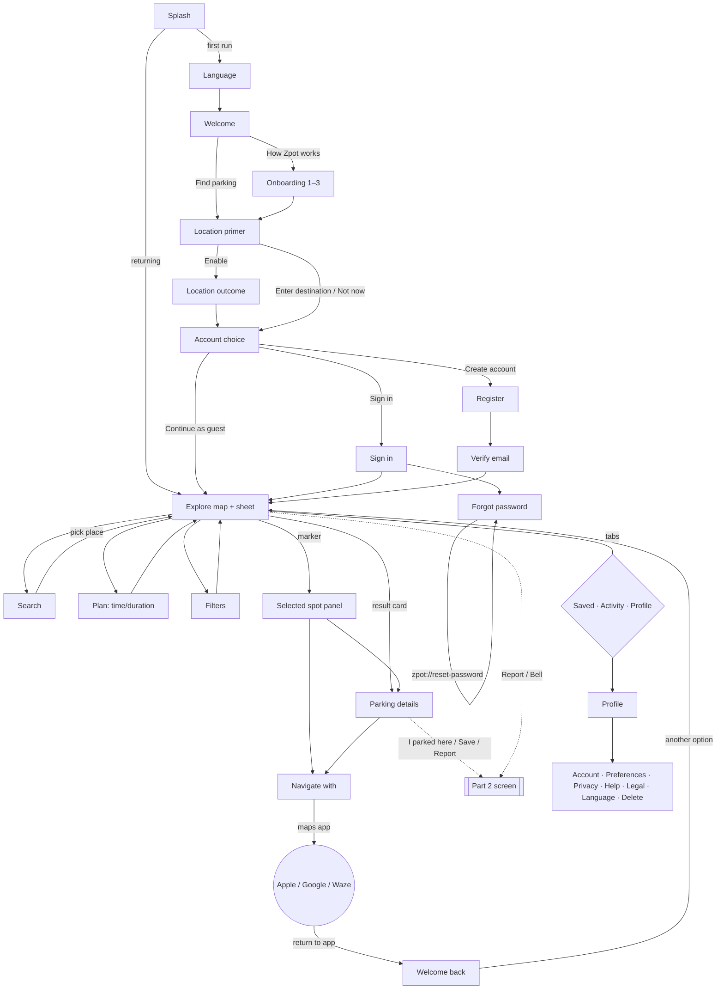

# Navigation matrix and user flows

The RN routes are in `mobile/src/navigation/RootNavigator.tsx` (root native stack) and `TabNavigator.tsx` (4 tabs). Deep links are in `linking.ts`.

## User flow

## Route table

| Route (RN) | Prototype screen | Reached from | Leaves to | Back behaviour | Params / deep link |
|---|---|---|---|---|---|
| Splash | splash | launch | Language (first run) / Main | — (reset) | — |
| Language | language | Splash; Profile | Welcome / back | back (settings mode) | `fromSettings` |
| Welcome | welcome | Language | LocationPermission, Onboarding | back | — |
| Onboarding | onboard | Welcome | LocationPermission | back = previous step | — |
| LocationPermission | locPerm | Welcome, Onboarding, Explore "Turn on location" | LocationOutcome, AccountChoice, Search | back | `fromSettings` |
| LocationOutcome | locOutcome | LocationPermission | AccountChoice / pop to top | back | — |
| AccountChoice | account | onboarding | Main, SignIn, Register (reset stack) | — | — |
| Main › Explore | explore | tabs, reset | Search, Plan, Filters, ParkingDetails, NavigationPicker, Part2, NotificationsIntro, LocationPermission | tab root | `zpot://explore` |
| Search (modal) | search | Explore bar; LocationPermission (manual) | back with destination; Plan | close | — |
| Plan (modal) | plan | Explore chip; Search; no-free state | back | close (draft discarded) | — |
| Filters (modal) | filters | Explore chip | back | close (draft discarded) | — |
| ParkingDetails | details | result card; selected spot; deep link | NavigationPicker, Explore (view on map), Part2 | back | `{id}` · `zpot://parking/:id` |
| NavigationPicker | navPick | details; selected spot | external app → NavigationReturn | back | `{id,name,latitude,longitude}` |
| NavigationReturn | navReturn | app foreground after hand-off | Explore, Part2 | close → Explore | — |
| SignIn / Register | signin / register | AccountChoice, Profile, each other | pending journey / VerifyEmail | back | `context` |
| VerifyEmail | verify | Register; Profile banner; deep link | back / Main | back | `zpot://verify-email?token=` |
| ForgotPassword | forgot | SignIn; deep link | SignIn | back | `zpot://reset-password?token=` |
| Legal | legal | Register links; Profile; Privacy | back | back | `tab` |
| AccountSettings / ParkingPreferences / Privacy / Help / DeleteAccount | acctMgmt / pprefs / privacy / help / deleteAcct | Profile | back / Main (after delete) | back | — |
| NotificationsIntro (modal) | nprefs (explanation) | Profile; Activity; Privacy | back | close | — |
| Part2 (modal) | session*, r*, saved actions, notifs | every Part 2 entry point | back | close | `{feature, areaId}` |

## Journey preservation

* **Guest to auth.** `authStore.pendingReturn` holds the route and params. After sign-in, `useFinishAuth` returns the user there. This is tested in `auth.test.tsx`.
* **External navigation.** `searchStore` persists the destination, plan, filters, selected id and `handoff` to AsyncStorage, so the selection survives the app being backgrounded or killed. `NavigationReturn` reloads the area.
* **Errors.** No screen is a dead end. Every screen has back or close, list states have retry buttons, and an `ErrorBoundary` resets to a safe state.

## Missing or broken routes found in the prototype audit

* `toLocPermFromMap` and `toLocPerm` reuse the onboarding primer. Mapped to `LocationPermission{fromSettings}` so it returns to Explore.
* `handoff` is a simulated external app. Replaced by real deep links plus the AppState return listener.
* The prototype guard (`renderVals`) silently falls back to Explore when a screen's draft data is missing, for example `plan` without a draft. RN screens own their drafts, so this can't happen.
